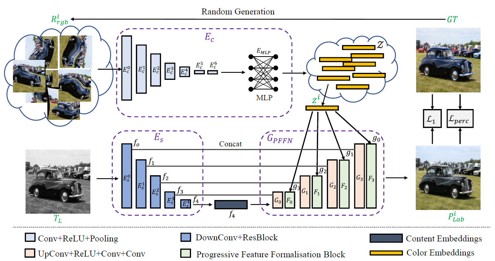
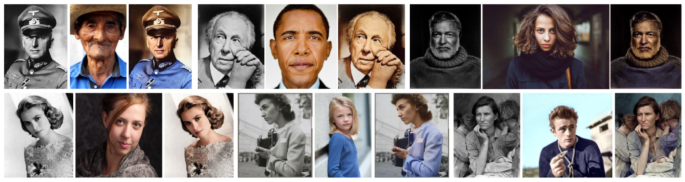
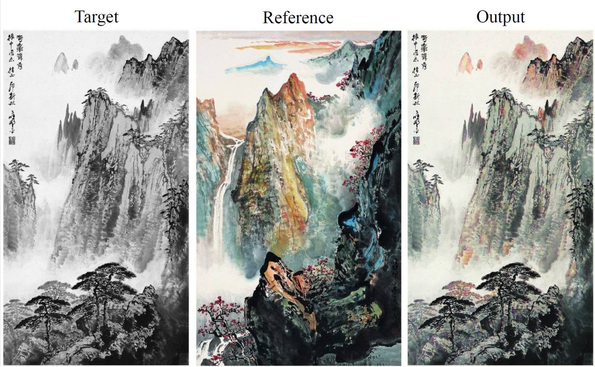

# Color2Embed
Color2Embed: Coloreado de imágenes rápido basado en ejemplos mediante incrustaciones de color [Paper](https://arxiv.org/abs/2106.08017)

Este proyecto es una implementación sencilla de Color2Embed. Este artículo posiblemente no haya sido enviado a ninguna conferencia o revista, por lo que puedes utilizarlo en tus proyectos. Si consideras que este repositorio es útil, puedes ayudar estrellándolo.

<p align="left">
  
</p>

Otros proyectos recomendados:

[Temporally-Consistent-Video-Colorization](https://github.com/lyh-18/TCVC-Temporally-Consistent-Video-Colorization)

[Deep Exemplar-based Colorization](https://github.com/msracver/Deep-Exemplar-based-Colorization)

[Deep Video Prior](https://github.com/ChenyangLEI/deep-video-prior)

[Learning Blind Video Temporal Consistency](https://github.com/phoenix104104/fast_blind_video_consistency)

[Swapping Autoencoder](https://github.com/taesungp/swapping-autoencoder-pytorch)

## Dependencias

- Python >= 3.6 (Se recomienda usar [Anaconda](https://www.anaconda.com/download/#linux))
- [PyTorch >= 1.5.0](https://pytorch.org/)

## Pruebas
1. Clona este repositorio de GitHub. 
```
git clone https://github.com/zhaohengyuan1/Color2Embed.git
cd Color2Embed
```

2. Los [modelos preentrenados](https://drive.google.com/file/d/15qgn3aSzviBE4tW6PaCx4c_syiKMBVir/view?usp=sharing) deben colocarse en la carpeta `./experiments/`. También se puede descargar el [modelo VGG](https://drive.google.com/file/d/1eMiUDeO_YGOu3RfyQKeAkKR5rgvH5a3d/view?usp=sharing).

3. He recopilado algunos conjuntos de datos de prueba utilizados en artículos anteriores. Puedes revisarlos en la ruta `./test_datasets`. Cuando utilices el archivo `test_gray2color.py` para realizar las pruebas, debes editar la ruta del archivo de entrada y la ruta de los pesos preentrenados dentro de ese archivo.

```
python test_gray2color.py
```

## Entrenamiento

1. Prepara los datos de entrenamiento.

```
cd data
sh prepare_data.sh
```

2. Ejecuta `train.sh`. Puedes consultar `train.py` para obtener más detalles sobre la implementación.

```
sh train.sh
```


## Resultados

<p align="left">
  
</p>

<p align="left">
  
</p>


## Contacto
Si tienes alguna pregunta, por favor envía un correo electrónico a hubylidayuan@gmail.com.
